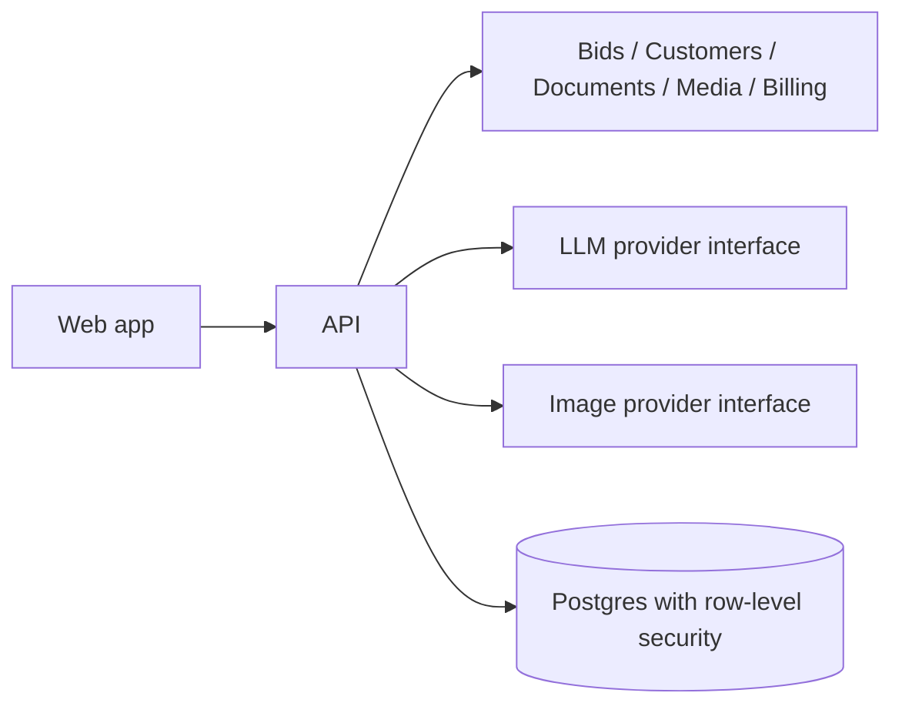

# BidCraft (working name BidPilot) — Showcase

**AI-powered bid management for small trade businesses.**

## The problem
Small trade shops like cabinet makers, painters and nurseries lose hours writing bids by hand, re-measuring, and tracking which quotes were sent or accepted.

## Intent and vision
Steven runs a cabinet shop and wants a tool that drafts a professional, branded bid from a conversation. You talk or type the job and measurements, and the AI agent builds line items, a clean 2D diagram and a PDF. Each business gets its own branded portal. AI usage comes with the plan and slows down instead of billing surprise overages. The first tenants are a cabinet shop, a painter and a plant business.

## Key features (v1)
- Multi-modal AI agent (chat and voice) that drafts bids
- CRM-lite: customers, job sites, bid status tracking
- Editable bids with version history
- Branded PDF output with black-and-white 2D diagrams from measurements
- Optional realistic renders of the proposed work
- Strict multi-tenancy and subscription plans with usage allotments

## Status
M0 Foundation is in progress: bounded-context skeleton, provider interfaces, tenancy model and docs.

## Architecture

## Tech stack
TypeScript, Postgres with RLS, pluggable LLM, transcription and image providers, Stripe for billing.

## Roadmap
Tenancy and sign-in, then CRM and bids, PDFs and diagrams, the AI agent, billing, and renders. Phase 2: room-photo modeling, mobile apps and e-signature.

---
**Source code is private.** This showcase describes the project and is updated as it progresses.
